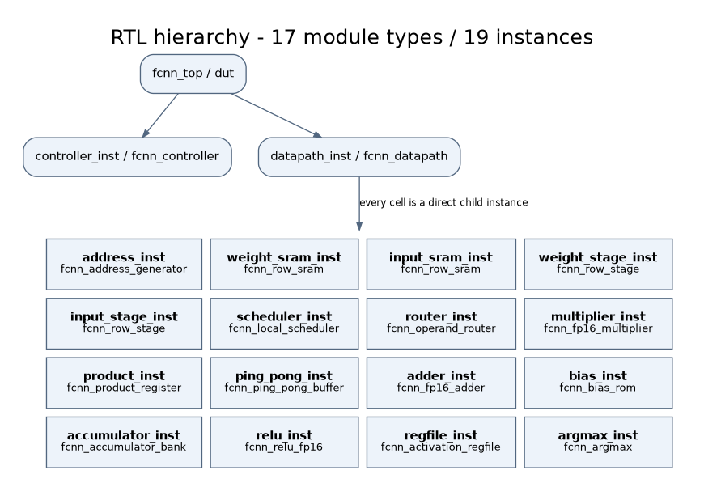
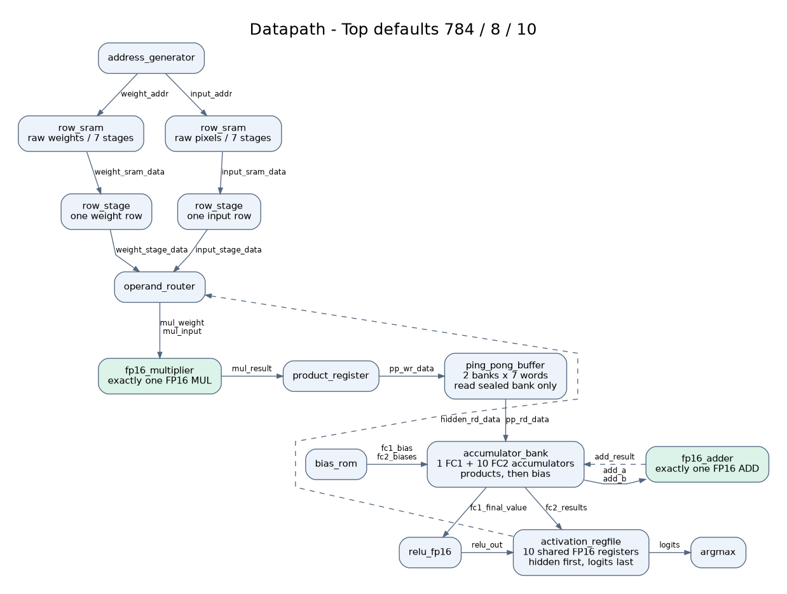
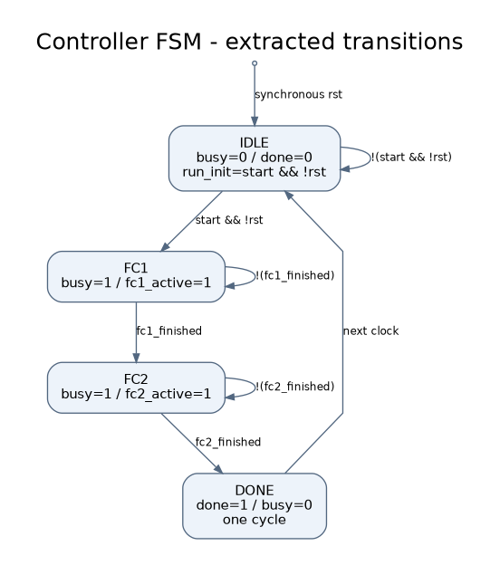

# تقسیم‌بندی جاری

این تقسیم‌بندی مطابق پیاده‌سازی اصلاح‌شده است. هدرها و اتصال هر پورت از خود RTL در `interfaces.md` و `architecture.json` تولید می‌شوند؛ یک کپی قابل کامپایل رقیب از headerها نگه داشته نمی‌شود.

| مرز | ماژول‌ها | مسئولیت |
|---|---|---|
| رابط خارجی | fcnn_top | پارامترهای عمومی و اتصال کنترل/داده |
| کنترل سراسری | fcnn_controller | پذیرش start، فاز لایه‌ها و done |
| تجمیع داده | fcnn_datapath | سیم‌بندی مسیرها و نمونه یکتای ADD/MUL |
| پیش‌واکشی | fcnn_address_generator، fcnn_local_scheduler | مالک آدرس و تقویم درخواست/مصرف |
| حافظه | دو نمونه fcnn_row_sram و دو نمونه fcnn_row_stage | ردیف وزن/تصویر و نگهداری تک‌ردیفی |
| عملوند و ضرب | fcnn_operand_router، fcnn_fp16_multiplier، fcnn_product_register | انتخاب lane، tag و ثبت محصول |
| بافر | fcnn_ping_pong_buffer | دو بانک کامل/آزاد، ترتیب FIFO و هندشیک |
| انباشت | fcnn_fp16_adder، fcnn_accumulator_bank، fcnn_bias_rom | جمع متوالی و بایاس نهایی با همان ADD |
| خروجی | fcnn_relu_fp16، fcnn_activation_regfile، fcnn_argmax | ReLU، RF مشترک و انتخاب خروجی |

۱۷ نوع ماژول و ۱۹ نمونه در hierarchy وجود دارد؛ تفاوت تعداد ناشی از دو نمونه SRAM و دو نمونه RowStage است. مسیر کنترل محلی داخل Datapath است ولی Controller تنها مالک FSM سراسری باقی می‌ماند. شمارنده‌های آدرس در Scheduler تکرار نشده‌اند.

